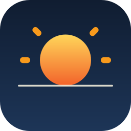

# Solstice



Solstice is a self-hosted game stream host for [Moonlight](https://moonlight-stream.org). It captures your Windows
desktop or a single application, encodes it in hardware, and streams it with low latency to any Moonlight client —
phone, tablet, TV, or another computer. A web UI handles pairing, configuration, and logging from any browser on your
network.

[](https://github.com/paulwongkwan/Solstice)
[](https://github.com/paulwongkwan/Solstice/releases/latest)
[](https://github.com/paulwongkwan/Solstice/actions/workflows/ci.yml?query=branch%3Amaster)

## Highlights

- **Windows 11 only.** x64 and ARM64 builds; Windows 11 build 22000 or newer is required, and older versions exit at
  startup with an explanatory message.
- **Hardware encoding.** NVENC on NVIDIA, AMF on AMD, QuickSync on Intel, Media Foundation on Qualcomm, with a software
  encoder as a fallback.
- **Desktop capture.** DXGI Desktop Duplication in both portable and service mode, Windows.Graphics.Capture in portable
  mode.
- **Virtual gamepads.** Xbox 360, Xbox One, Xbox Series, DualShock 4, DualSense, Switch Pro, and Steam Controller
  emulation, either fixed or selected automatically from the client's controller, through
  [libvirtualgamepad](https://github.com/Nonary/libvirtualgamepad) or
  [HIDMaestro](https://github.com/hifihedgehog/HIDMaestro) with the
  [ViGEmBus](https://github.com/nefarius/ViGEmBus) fallback.
- **Web UI with sign-in.** Pair clients, change settings, and read logs from `https://localhost:47990`, protected by a
  login screen with an optional "remember me" session.
- **Sunshine-compatible.** Existing Sunshine configuration is picked up automatically, and the client, application, and
  state file formats are unchanged.

## Requirements

| Component | Requirement |
|:----------|:------------|
| OS | Windows 11 (build 22000) or newer, x64 or ARM64 |
| GPU | NVIDIA: NVENC-capable GPU ([support matrix](https://developer.nvidia.com/video-encode-and-decode-gpu-support-matrix-new)) |
| | AMD: VCE 1.0 or newer ([supported hardware](https://github.com/obsproject/obs-amd-encoder/wiki/Hardware-Support)) |
| | Intel: Skylake or newer with QuickSync |
| | Qualcomm: Media Foundation encoding |
| CPU | AMD Ryzen 3 / Intel Core i3 or better |
| RAM | 4 GB or more |
| Network | 5 GHz 802.11ac or wired Ethernet on both host and client |

A 4K or HDR stream benefits from a modern mid-range GPU (GTX 1080 / VCE 3.1 / HD Graphics 730 or better), a Ryzen 5 or
Core i5, and wired Ethernet on both ends. These recommendations are a work in progress — do not buy hardware based on
them alone.

> [!NOTE]
> Virtual gamepads need a driver. The installer ships the
> [libvirtualgamepad](https://github.com/Nonary/libvirtualgamepad) package under `drivers\vhf-gamepad` but does not
> install it, because its catalog has to be signed for each distribution;
> [HIDMaestro](https://github.com/hifihedgehog/HIDMaestro) and the
> [ViGEmBus](https://github.com/nefarius/ViGEmBus/releases/latest) fallback cover the same profiles when it is not
> installed. Without a driver, keyboard, mouse, touch, and pen input still work.

## Install

1. Download [`Solstice.exe`](https://github.com/paulwongkwan/Solstice/releases/download/v2026.1120.194334/Solstice.exe)
   from the [releases page](https://github.com/paulwongkwan/Solstice/releases).
2. Run the installer. It installs to `%ProgramFiles%\Solstice`, adds the firewall rules, and registers
   `SolsticeService`, so Solstice keeps streaming after you sign out of Windows.
3. Open <https://localhost:47990> and create your Web UI credentials on first launch.

The published installer is an AMD64 build; there is no ARM64 installer yet, so ARM64 hosts build from source. The
releases also do not include the portable archive, which `cpack -G ZIP` produces from a local build.

## Pair a client

1. In Moonlight, add a host and enter the address of the machine running Solstice.
2. Moonlight shows a four-digit PIN.
3. Enter that PIN in the Solstice Web UI, or from the Solstice tray icon, and accept the pairing request.

## Configuration

Solstice keeps its state in a `config` directory beside the executable:

| File | Purpose |
|:-----|:--------|
| `solstice.conf` | Host settings, including encoder, resolution, and audio configuration |
| `apps.json` | Applications and desktop entries shown in Moonlight |
| `solstice_state.json` | Persistent runtime state such as the unique host ID |
| `solstice.log` | Log output, also viewable in the Web UI |
| `credentials/` | TLS key and certificate used by the Web UI |

The Web UI username and password hash are stored in `solstice.conf`.

The installed build uses `%ProgramFiles%\Solstice\config`. On first start Solstice copies any configuration it finds in
`%ProgramFiles%\Sunshine\config`, so an existing Sunshine installation can be replaced without redoing the setup.

See [configuration.md](docs/configuration.md) for every option, and [getting_started.md](docs/getting_started.md) for a
guided setup.

## Web UI sign-in

- The first visit redirects to a welcome page where you set the username and password.
- Later visits show a login screen. Select **Remember me** to stay signed in on that browser for 30 days; otherwise the
  session ends when the browser closes.
- Changing the password invalidates every remembered session, and **Log out** clears the cookie on the current browser.
- Scripted clients can keep using HTTP basic authentication against the same credentials; see [api.md](docs/api.md).

## Build from source

Solstice builds on Windows with MSYS2 UCRT64 (or CLANGARM64 on ARM64); cross-compilation is not supported. The full
prerequisites, including Boost, Qt, and Node.js, are listed in [building.md](docs/building.md).

```bash
cmake -B cmake-build-release -G Ninja -S . -DCMAKE_BUILD_TYPE=RelWithDebInfo
cmake --build cmake-build-release
```

The resulting binaries are `cmake-build-release/solstice.exe` and `cmake-build-release/tools/solsticesvc.exe`. CPack
produces the NSIS installer `Solstice.exe`; add `-G ZIP` for the portable archive, or `-G WIX` for an MSI (the MSI needs
the WiX toolset):

```bash
cpack --config cmake-build-release/CPackConfig.cmake
```

### Tests

The test suite uses GoogleTest and is built by default. Run it with:

```bash
cmake -B cmake-build-release -G Ninja -S . -DCMAKE_BUILD_TYPE=RelWithDebInfo
cmake --build cmake-build-release
cmake-build-release/tests/test_sunshine
```

Pass `-DBUILD_TESTS=OFF` to skip building the tests, and `-DBUILD_DOCS=OFF` to skip the documentation target.

The tests cover configuration parsing, legacy configuration migration, and the web assets; see
[contributing.md](docs/contributing.md) for the layout and conventions.

## Documentation

- [Getting started](docs/getting_started.md)
- [Configuration reference](docs/configuration.md)
- [API reference](docs/api.md)
- [Troubleshooting](docs/troubleshooting.md)
- [Performance tuning](docs/performance_tuning.md)
- [Building](docs/building.md)
- [Contributing](docs/contributing.md)

## Contributing

Bug reports and pull requests are welcome. Please open an issue with the observed behavior, the expected behavior, and
the relevant log lines before sending a change, and read [contributing.md](docs/contributing.md) for the code style,
localization, and testing rules.

## Credits

Solstice is built on [Moonlight](https://moonlight-stream.org) for the client side, [ViGEmBus](https://github.com/nefarius/ViGEmBus)
for virtual gamepads, and [FFmpeg](https://ffmpeg.org) for media handling. Thank you to everyone who maintains those
projects.

## License

Solstice is distributed under the terms in [LICENSE](LICENSE). Third-party components and their licenses are listed in
[NOTICE](NOTICE).
